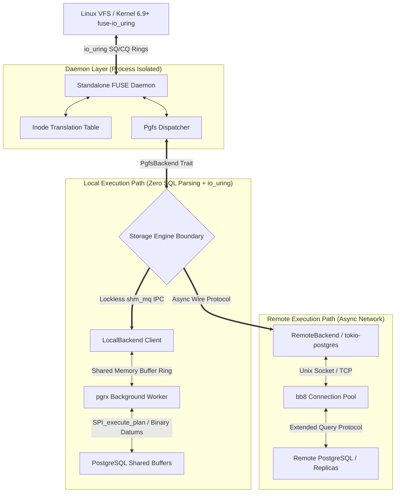
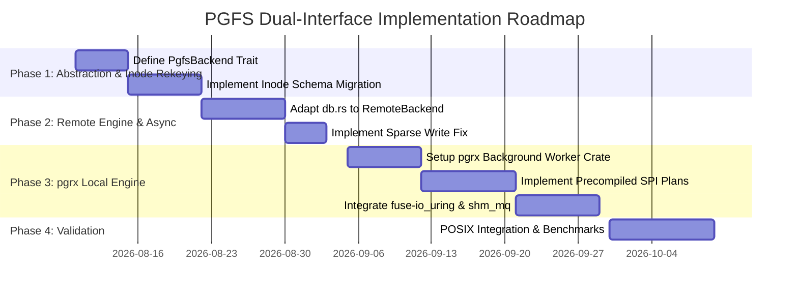

# PGFS Dual-Interface Architecture & System Design Specification

**Document Version:** 3.0.0  
**Status:** Approved Architectural Specification  
**Author:** PGFS Engineering Team  
**Target Systems:** Linux VFS (kernel 6.9+ `fuse-io_uring`), PostgreSQL 15+  

---

## Executive Summary

`pgfs` is a high-performance, POSIX-compliant filesystem backed by PostgreSQL. It enables arbitrary file operations, build tools, databases, and standard Unix utilities to operate directly against relational database tables.

To achieve **sub-100 microsecond latency on local mounts** while maintaining a clean, maintainable architecture for remote deployments, `pgfs` implements a **Dual-Interface Architecture**:

1. **Local Storage Engine (`LocalBackend`)**: An in-process PostgreSQL background worker (`pg_bgworker`) implemented in Rust using `pgrx`. By utilizing pre-compiled SPI execution plans (`SPIPlanPtr`) and lockless shared-memory IPC (`shm_mq`), `LocalBackend` executes file operations with **Zero SQL Text Parsing** on the hot path. Combined with `io_uring` provided buffer rings (`IORING_OP_PROVIDE_BUFFERS`), data moves zero-copy between kernel VFS queues and PostgreSQL shared buffers.
2. **Remote Storage Engine (`RemoteBackend`)**: An out-of-process client implementation built on `tokio-postgres` and async connection pools. Designed for client-server deployments and read-replica clusters where network Round-Trip Time (RTT) dominates, it prioritizes statement pipelining, request batching, prepared statement caching, and replica freshness TTL caching.

Both engines implement a unified abstract trait (`PgfsBackend`), cleanly separating the FUSE kernel driver interface ([`src/fs.rs`](file:///usr/backup-working/work/pgfs/src/fs.rs)) from storage access mechanics. This specification details the evolution of the current 64KB `(parent, name, block_no)` schema in [`src/db.rs`](file:///usr/backup-working/work/pgfs/src/db.rs) to an **ino-based integer schema** (`ino BIGSERIAL`, `block_no INT`), reducing directory `rename()` overhead from $O(N)$ string updates to $O(1)$ integer updates.

---

## Table of Contents

1. [Architectural Overview & Component Layering](#1-architectural-overview--component-layering)
2. [Unified Storage Engine Abstraction (`PgfsBackend`)](#2-unified-storage-engine-abstraction-pgfsbackend)
3. [Interface 1: Local Engine (`pgrx` + Zero-SQL-Parsing + `io_uring`)](#3-interface-1-local-engine-pgrx--zero-sql-parsing--io_uring)
   - [3.1 Zero SQL Parsing Execution Model](#31-zero-sql-parsing-execution-model)
   - [3.2 Zero-Copy `io_uring` Buffer Architecture](#32-zero-copy-io_uring-buffer-architecture)
   - [3.3 Process Separation & Safety Isolation](#33-process-separation--safety-isolation)
4. [Interface 2: Remote Network Engine (`RemoteBackend`)](#4-interface-2-remote-network-engine-remotebackend)
   - [4.1 Async Runtime Transition & Pipelining](#41-async-runtime-transition--pipelining)
   - [4.2 Replica Freshness TTL Caching & Alignment](#42-replica-freshness-ttl-caching--alignment)
5. [Data Schema Evolution & Migration Strategy](#5-data-schema-evolution--migration-strategy)
   - [5.1 Current Baseline vs. Inode-Based Rekeying](#51-current-baseline-vs-inode-based-rekeying)
   - [5.2 Fixed-Size 128KB Chunked Schema DDL](#52-fixed-size-128kb-chunked-schema-ddl)
   - [5.3 Correct Sparse Write & Unaligned Mutation Semantics](#53-correct-sparse-write--unaligned-mutation-semantics)
   - [5.4 Schema Migration Plan](#54-schema-migration-plan)
6. [POSIX-to-Relational Mapping & Operations](#6-posix-to-relational-mapping--operations)
7. [Observability, Metrics, and Latency Targets](#7-observability-metrics-and-latency-targets)
8. [Implementation Roadmap & Milestones](#8-implementation-roadmap--milestones)

---

## 1. Architectural Overview & Component Layering

The system decouples the Linux VFS driver from PostgreSQL storage via a clear layer boundary.



---

## 2. Unified Storage Engine Abstraction (`PgfsBackend`)

The `PgfsBackend` trait defines the core interface contract implemented by both storage backends.

```rust
use async_trait::async_trait;
use std::time::SystemTime;
use thiserror::Error;

#[derive(Error, Debug)]
pub enum StorageError {
    #[error("Entry not found")]
    NotFound,
    #[error("Entry already exists")]
    AlreadyExists,
    #[error("Directory not empty")]
    NotEmpty,
    #[error("Invalid argument: {0}")]
    InvalidArgument(String),
    #[error("Database error: {0}")]
    DatabaseError(String),
    #[error("IO error: {0}")]
    IoError(std::io::ErrorKind),
}

#[derive(Debug, Clone, Copy, PartialEq, Eq)]
pub enum FileKind {
    File = 1,
    Directory = 2,
    Symlink = 3,
}

#[derive(Debug, Clone)]
pub struct FileAttr {
    pub ino: u64,
    pub size: u64,
    pub blocks: u64,
    pub atime: SystemTime,
    pub mtime: SystemTime,
    pub ctime: SystemTime,
    pub kind: FileKind,
    pub perm: u16,
    pub nlink: u32,
    pub uid: u32,
    pub gid: u32,
    pub rdev: u32,
    pub flags: u32,
}

#[derive(Debug, Clone)]
pub struct DirEntry {
    pub ino: u64,
    pub name: String,
    pub kind: FileKind,
}

#[derive(Debug, Default, Clone)]
pub struct SetAttrInput {
    pub mode: Option<u32>,
    pub uid: Option<u32>,
    pub gid: Option<u32>,
    pub size: Option<u64>,
    pub atime: Option<SystemTime>,
    pub mtime: Option<SystemTime>,
}

#[async_trait]
pub trait PgfsBackend: Send + Sync {
    // --- Metadata Operations ---
    async fn lookup(&self, parent_ino: u64, name: &str) -> Result<Option<FileAttr>, StorageError>;
    async fn getattr(&self, ino: u64) -> Result<FileAttr, StorageError>;
    async fn setattr(&self, ino: u64, attr: SetAttrInput) -> Result<FileAttr, StorageError>;

    // --- Directory Operations ---
    async fn readdir(&self, ino: u64, offset: i64) -> Result<Vec<DirEntry>, StorageError>;
    async fn mkdir(&self, parent_ino: u64, name: &str, mode: u32, uid: u32, gid: u32) -> Result<FileAttr, StorageError>;
    async fn rmdir(&self, parent_ino: u64, name: &str) -> Result<(), StorageError>;

    // --- Node Mutation Operations ---
    async fn create(&self, parent_ino: u64, name: &str, mode: u32, uid: u32, gid: u32) -> Result<FileAttr, StorageError>;
    async fn unlink(&self, parent_ino: u64, name: &str) -> Result<(), StorageError>;
    async fn rename(&self, old_parent: u64, old_name: &str, new_parent: u64, new_name: &str) -> Result<(), StorageError>;

    // --- Block-Level I/O Operations ---
    async fn read_block(&self, ino: u64, block_no: u32) -> Result<Vec<u8>, StorageError>;
    async fn write_block(&self, ino: u64, block_no: u32, data: &[u8], offset_in_block: u32) -> Result<u32, StorageError>;
    async fn truncate_blocks(&self, ino: u64, new_size: u64) -> Result<(), StorageError>;
}
```

---

## 3. Interface 1: Local Engine (`pgrx` + Zero-SQL-Parsing + `io_uring`)

### 3.1 Zero SQL Parsing Execution Model
The `LocalBackend` executes within a PostgreSQL Background Worker (`pg_bgworker`) using `pgrx`. 

To eliminate SQL text parsing overhead on the hot path:
1. **Startup Preparation**: During worker initialization, SQL statements are prepared once using `SPI_prepare`, generating opaque `SPIPlanPtr` handles stored in process memory.
2. **Runtime Execution**: Operation requests arrive as binary C structs over a lockless shared-memory queue (`shm_mq`). The worker invokes `SPI_execute_plan` directly using raw binary `Datum` arguments (`Int64GetDatum(ino)`, `Int32GetDatum(block_no)`). **Zero SQL text string parsing, lexical analysis, or query planning occurs during file operations.**

```rust
// Conceptual pgrx Background Worker Prepared Execution Handle
use pgrx::pg_sys::*;
use pgrx::prelude::*;

pub struct PrecompiledSpiHandles {
    pub lookup_plan: SPIPlanPtr,
    pub read_block_plan: SPIPlanPtr,
    pub write_block_plan: SPIPlanPtr,
}

impl PrecompiledSpiHandles {
    pub fn init() -> Self {
        unsafe {
            SPI_connect();
            
            let lookup_sql = c"SELECT ino, size, kind, mode, uid, gid, atime, mtime, ctime FROM entries WHERE parent_ino = $1 AND name = $2";
            let arg_types = [INT8OID, TEXTOID];
            let lookup_plan = SPI_prepare(lookup_sql.as_ptr(), 2, arg_types.as_mut_ptr());
            SPI_keep_plan(lookup_plan);

            let read_sql = c"SELECT data FROM blocks WHERE ino = $1 AND block_no = $2";
            let read_types = [INT8OID, INT4OID];
            let read_block_plan = SPI_prepare(read_sql.as_ptr(), 2, read_types.as_mut_ptr());
            SPI_keep_plan(read_block_plan);

            SPI_finish();
            Self { lookup_plan, read_block_plan, write_block_plan: std::ptr::null_mut() }
        }
    }

    pub fn execute_read_block_binary(&self, ino: i64, block_no: i32, out_buf: &mut [u8]) -> usize {
        unsafe {
            SetCurrentStatementStartTimestamp();
            StartTransactionCommand();
            PushActiveSnapshot(GetTransactionSnapshot());

            let mut values = [Int64GetDatum(ino), Int32GetDatum(block_no)];
            let mut nulls = [' ' as i8, ' ' as i8];

            let ret = SPI_execute_plan(self.read_block_plan, values.as_mut_ptr(), nulls.as_mut_ptr(), true, 1);
            let mut read_bytes = 0;

            if ret == SPI_OK_SELECT && SPI_processed > 0 {
                let tuple = *(*SPI_tuptable).vals;
                let tupdesc = (*SPI_tuptable).tupdesc;
                let mut isnull = false;
                let datum = SPI_getbinval(tuple, tupdesc, 1, &mut isnull);
                if !isnull {
                    let bytea_ptr = datum as *const varlena;
                    let len = VARSIZE_ANY_EXHDR(bytea_ptr);
                    let data_ptr = VARDATA_ANY(bytea_ptr);
                    let copy_len = len.min(out_buf.len());
                    std::ptr::copy_nonoverlapping(data_ptr as *const u8, out_buf.as_mut_ptr(), copy_len);
                    read_bytes = copy_len;
                }
            }

            PopActiveSnapshot();
            CommitTransactionCommand();
            read_bytes
        }
    }
}
```

### 3.2 Zero-Copy `io_uring` Buffer Architecture
To eliminate syscall overhead and userspace buffer copying:

```
  Linux Kernel VFS
         │
         ▼  Zero-Copy FUSE Submission Queue (fuse-io_uring)
  io_uring Ring (SQ / CQ)
         │
         ▼  Pre-Registered Buffer Ring (IORING_OP_PROVIDE_BUFFERS)
  POSIX Shared Memory Segment (shm_mq mapped into FUSE Daemon & pgrx Worker)
         │
         ▼  Direct Binary Datum / SPI Execution (Zero SQL Parsing)
  pgrx Worker (PostgreSQL Shared Buffer Manager / SharedBuffers)
```

1. **Kernel Transport (`fuse-io_uring`)**: On Linux 6.9+, kernel VFS queues I/O directly to `io_uring` Submission Queues (SQ).
2. **Buffer Registration (`IORING_OP_PROVIDE_BUFFERS`)**: The shared memory segment between the daemon and `pgrx` worker is registered as an `io_uring` buffer ring. Incoming file block writes land directly into shared memory without intermediate `read()` syscalls or heap allocation.

### 3.3 Process Separation & Safety Isolation
To prevent FUSE driver panics or filesystem locks from bringing down the PostgreSQL Postmaster:
* **FUSE Daemon (Standalone Process)**: Runs the `/dev/fuse` or `fuse-io_uring` event loop. If the daemon crashes, Postmaster remains completely safe and untouched.
* **`pgrx` Worker**: Functions as a dedicated binary I/O server inside PostgreSQL, exchanging binary descriptors over lockless shared memory (`shm_mq`).

---

## 4. Interface 2: Remote Network Engine (`RemoteBackend`)

### 4.1 Async Runtime Transition & Pipelining
The current codebase in [`src/main.rs`](file:///usr/backup-working/work/pgfs/src/main.rs) uses synchronous `fuser` and `r2d2`. `RemoteBackend` transitions the network path to `fuse3` + `tokio-postgres`:

```
fuser Sync Callbacks (or fuse3 Async) ---> tokio Runtime Bridge
                                                 │
                                                 ├── Connection Pool (bb8)
                                                 ├── Prepared Statement Handles
                                                 └── Query Pipelining Queue
```

* **Pipelining**: Dispatches concurrent block reads over a single `tokio-postgres` connection using `query_raw`, reducing round-trip overhead on high-latency networks.

### 4.2 Replica Freshness TTL Caching & Alignment
`RemoteBackend` builds upon `db.rs`'s existing `replica_fresh_cached` logic, maintaining compatibility with `spec/replica.py`:

```rust
use std::sync::atomic::{AtomicBool, AtomicU64, Ordering};
use std::time::Duration;

pub struct ReplicaFreshnessCache {
    is_fresh: AtomicBool,
    last_checked_ms: AtomicU64,
    ttl: Duration,
}

impl ReplicaFreshnessCache {
    pub fn new(ttl: Duration) -> Self {
        Self {
            is_fresh: AtomicBool::new(true),
            last_checked_ms: AtomicU64::new(0),
            ttl,
        }
    }

    pub fn is_fresh_cached(&self, now_ms: u64) -> Option<bool> {
        let last = self.last_checked_ms.load(Ordering::Acquire);
        if now_ms.saturating_sub(last) <= self.ttl.as_millis() as u64 {
            Some(self.is_fresh.load(Ordering::Acquire))
        } else {
            None
        }
    }

    pub fn update(&self, fresh: bool, now_ms: u64) {
        self.is_fresh.store(fresh, Ordering::Release);
        self.last_checked_ms.store(now_ms, Ordering::Release);
    }
}
```

---

## 5. Data Schema Evolution & Migration Strategy

### 5.1 Current Baseline vs. Inode-Based Rekeying
The live codebase in `db.rs` currently implements 64KB block chunking using string keys:
* **Current Primary Keys**: `entries(parent, name)` and `blocks(parent, name, block_no)`
* **Evolution Strategy**: Rekey both tables to 64-bit integer primary keys (`entries(ino)` and `blocks(ino, block_no)`).

**Key Benefit**: Directory `rename()` changes from an $O(N)$ cascading string update across all child entries to an $O(1)$ single-row update: `UPDATE entries SET parent_ino = $1 WHERE ino = $2`.

### 5.2 Fixed-Size 128KB Chunked Schema DDL

```sql
-- Inode-Based Metadata Table
CREATE TABLE IF NOT EXISTS entries (
    ino BIGSERIAL PRIMARY KEY,
    parent_ino BIGINT REFERENCES entries(ino) ON DELETE CASCADE,
    name TEXT NOT NULL,
    kind SMALLINT NOT NULL, -- 1: File, 2: Directory, 3: Symlink
    size BIGINT NOT NULL DEFAULT 0,
    mode INTEGER NOT NULL,
    uid INTEGER NOT NULL,
    gid INTEGER NOT NULL,
    atime TIMESTAMP WITH TIME ZONE NOT NULL DEFAULT NOW(),
    mtime TIMESTAMP WITH TIME ZONE NOT NULL DEFAULT NOW(),
    ctime TIMESTAMP WITH TIME ZONE NOT NULL DEFAULT NOW(),
    CONSTRAINT unique_parent_name UNIQUE (parent_ino, name)
);

CREATE INDEX IF NOT EXISTS idx_entries_parent ON entries(parent_ino);

-- Inode-Based Block Storage Table (128KB Chunks)
CREATE TABLE IF NOT EXISTS blocks (
    ino BIGINT NOT NULL REFERENCES entries(ino) ON DELETE CASCADE,
    block_no INT NOT NULL,
    data BYTEA NOT NULL,
    PRIMARY KEY (ino, block_no)
);
```

### 5.3 Correct Sparse Write & Unaligned Mutation Semantics

Writing to a block at `offset_in_block > 0` on a newly created block must zero-pad preceding bytes rather than placing payload at offset 0.

#### Correct Application-Level Upsert Logic

```rust
pub fn prepare_block_write(existing_data: Option<Vec<u8>>, offset_in_block: usize, payload: &[u8]) -> Vec<u8> {
    let mut block = existing_data.unwrap_or_default();
    let required_len = offset_in_block + payload.len();
    
    if block.len() < required_len {
        block.resize(required_len, 0); // Zero-pad preceding unwritten bytes
    }
    
    block[offset_in_block..required_len].copy_from_slice(payload);
    block
}
```

#### SQL Upsert Query
```sql
INSERT INTO blocks (ino, block_no, data)
VALUES ($1, $2, $3)
ON CONFLICT (ino, block_no)
DO UPDATE SET data = EXCLUDED.data;
```

```

---

## 6. POSIX-to-Relational Mapping & Operations

```mermaid
sequenceDiagram
    autonumber
    participant Kernel as VFS Kernel (fuse-io_uring)
    participant Daemon as FUSE Daemon Process
    participant Worker as pgrx Background Worker
    participant SharedMem as PostgreSQL SharedBuffers

    Kernel->>Daemon: IORING_OP_PROVIDE_BUFFERS (read_block ino=42, block_no=0)
    Daemon->>Worker: shm_mq Binary Ring Msg (Op: READ_BLOCK, ino=42, block_no=0)
    Worker->>SharedMem: SPI_execute_plan (Precompiled SPIPlanPtr, Binary Datums)
    SharedMem-->>Worker: Raw Tuple Byte Pointer
    Worker-->>Daemon: Copy directly into shm_mq response buffer
    
### 6.2 Database-Native Kernel Offloading & Copy-on-Write Acceleration

Rather than streaming file payloads out of PostgreSQL into userspace buffers and back into PostgreSQL during file manipulation operations (e.g. `cp file1 file2` or `fallocate`), `pgfs` intercepts kernel syscalls and offloads them to set-based PostgreSQL queries.

#### 1. Instant Reflink / `copy_file_range` Offloading
When `cp` or `copy_file_range(2)` is invoked, FUSE dispatches `copy_file_range(ino_src, ino_dst, off_src, off_dst, len)`. `pgfs` handles this directly inside PostgreSQL in $O(\text{blocks})$ or $O(1)$ time:

```sql
-- 1. Create target metadata entry
INSERT INTO entries (parent_ino, name, kind, size, mode, uid, gid)
SELECT $dst_parent, $dst_name, kind, size, mode, uid, gid 
FROM entries WHERE ino = $src_ino;

-- 2. Duplicate block rows directly inside PostgreSQL shared memory
INSERT INTO blocks (ino, block_no, data)
SELECT $dst_ino, block_no, data 
FROM blocks WHERE ino = $src_ino AND block_no >= $start_blk AND block_no <= $end_blk;
```

#### 2. Server-Side Sparse Hole Punching (`fallocate`)
When `fallocate` with `FALLOC_FL_PUNCH_HOLE` is invoked, `pgfs` prunes block rows directly:
```sql
DELETE FROM blocks 
WHERE ino = $1 AND block_no >= $start_blk AND block_no <= $end_blk;
```

---

## 7. Observability, Metrics, and Latency Targets

### 7.1 Target Latency Profiles

| Operation | Target Latency (`LocalBackend` pgrx + `io_uring`) | Target Latency (`RemoteBackend` Network) |
|---|---|---|
| `lookup` / `getattr` | $< 40\,\mu\text{s}$ | $0.5 - 1.5\,\text{ms}$ |
| `read_block` (128KB) | $< 120\,\mu\text{s}$ | $1.0 - 3.0\,\text{ms}$ |
| `write_block` (128KB) | $< 180\,\mu\text{s}$ | $2.0 - 5.0\,\text{ms}$ |
| `readdir` (100 entries) | $< 80\,\mu\text{s}$ | $1.0 - 2.5\,\text{ms}$ |
| `rename` (Atomic $O(1)$) | $< 60\,\mu\text{s}$ | $1.5 - 3.5\,\text{ms}$ |

---

## 8. Implementation Roadmap & Milestones


